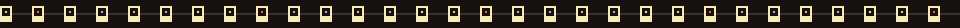

<div align="center">



<br>

<a href="https://github.com/G1ts-3/RaKeepsake/releases/latest"></a>


**Pantau live, rekam otomatis, unduh postingan baru. Semuanya rapi di satu pustaka.**

</div>



## 📼 Apa itu RaKeepsake?

RaKeepsake adalah aplikasi Android untuk menyimpan momen yang kamu suka dari tiga platform:

| Platform | Live | Postingan / Story |
| :--- | :---: | :---: |
| **TikTok** | ✅ | ✅ |
| **SHOWROOM** | ✅ | — |
| **IDN Live** | ✅ | — |

Tambahkan akun sekali, lalu biarkan aplikasi bekerja di latar belakang. Begitu akun mulai live, RaKeepsake merekamnya otomatis. Begitu ada postingan atau story baru di TikTok, RaKeepsake mengunduhnya otomatis.




## 📲 Unduh & pasang

<div align="center">

<a href="https://github.com/G1ts-3/RaKeepsake/releases/latest"></a>

</div>

| Pilihan | Link |
| :--- | :--- |
| Rilis terbaru (selalu update) | [Releases → Latest](https://github.com/G1ts-3/RaKeepsake/releases/latest) |
| Langsung APK v0.2.1 | [RaKeepsake-v0.2.1.apk](https://github.com/G1ts-3/RaKeepsake/releases/download/v0.2.1/RaKeepsake-v0.2.1.apk) |
| Semua versi | [Daftar rilis](https://github.com/G1ts-3/RaKeepsake/releases) |

**Cara pasang**
1. Unduh berkas `.apk` dari halaman rilis di atas.
2. Buka berkasnya dari HP. Kalau diminta, izinkan *Install dari sumber ini* untuk browser atau file manager yang kamu pakai.
3. Buka RaKeepsake, beri izin notifikasi dan penyimpanan, lalu matikan optimasi baterai untuk aplikasi ini supaya perekaman tidak dimatikan sistem.
4. Versi berikutnya bisa diperbarui langsung dari dalam aplikasi lewat menu **Setelan**.

> Butuh Android 8.0 (API 26) atau lebih baru.


## 🕹️ Fitur

**🔴 Pemantau live**
- Berjalan sebagai *foreground service* dengan notifikasi status, tetap hidup saat layar mati.
- Merekam stream HLS dan FLV, lalu menyatukannya jadi berkas **MP4** yang bisa langsung diputar.
- Otomatis aktif lagi setelah HP restart.

**🎞️ Pemantau postingan (TikTok)**
- Membandingkan postingan terbaru dengan yang sudah tersimpan, lalu mengantrekan unduhan untuk yang baru saja.
- Mendukung postingan dan story, dengan opsi hanya mengambil audio.

**🗂️ Pustaka**
- Semua hasil rekaman dan unduhan terkumpul di satu tempat, lengkap dengan thumbnail.
- Kategori berwarna untuk story, postingan, foto, dan audio.

**👤 Akun**
- Tambah akun per platform, tandai favorit, dan pilih mau merekam, hanya memberi notifikasi, atau memantau postingan.
- Impor dan ekspor daftar akun lewat berkas roster `members.json`.

**⚙️ Setelan**
- Jendela waktu aktif, misalnya 18:00–23:00 atau lintas tengah malam 21:00–02:00.
- Sesi TikTok, mode audio saja, dan penghemat baterai.
- Pembaruan aplikasi mandiri lewat [GitHub Releases](https://github.com/G1ts-3/RaKeepsake/releases).


## 🧭 Navigasi

| Tab | Isinya |
| :--- | :--- |
| **Live** | Siapa yang sedang live dan status perekaman |
| **Postingan** | Postingan dan story yang terdeteksi atau sedang diunduh |
| **Pustaka** | Semua hasil tersimpan |
| **Akun** | Daftar akun yang dipantau |
| **Setelan** | Jadwal, sesi, dan pembaruan |

## 🎨 Palet

Tema gelap hangat dengan aksen kuning, mengikuti logo Polaroid-nya.

| Peran | Warna | Hex |
| :--- | :---: | :--- |
| Latar |  | `#18120F` |
| Permukaan |  | `#211A17` |
| Teks |  | `#EDE0DA` |
| **Aksen "Ra"** |  | `#FFC85A` |
| Live / REC |  | `#FF5A4F` |
| Pita |  | `#D8433F` |
| Story |  | `#B8A6FF` |
| Postingan |  | `#6FD6C2` |
| Foto |  | `#FFB36B` |
| Audio |  | `#8FC7FF` |

Font: **Plus Jakarta Sans**.


## 🧱 Teknologi

| | |
| :--- | :--- |
| Bahasa & UI | Kotlin, Jetpack Compose, Material 3 |
| Data | Room, DataStore |
| Latar belakang | WorkManager, Foreground Service |
| Jaringan | OkHttp, kotlinx.serialization |
| Media | Media3 ExoPlayer (HLS), remuxer FLV/TS ke MP4 |
| Gambar | Coil |
| Target | `minSdk 26` · `targetSdk 35` |

## 🛠️ Build dari source

1. Clone repo ini.
   ```bash
   git clone https://github.com/G1ts-3/RaKeepsake.git
   ```
2. Buka foldernya di **Android Studio** dan tunggu Gradle sync selesai.
3. Pilih varian build lalu jalankan di HP atau emulator.

| Varian | Kegunaan |
| :--- | :--- |
| `fast` | Build cepat untuk uji coba, ditandatangani dengan debug key |
| `release` | Build rilis, butuh `keystore.properties` di root proyek |

Untuk build rilis, buat `keystore.properties` (sudah masuk `.gitignore`):

```properties
storeFile=path/ke/keystore.jks
storePassword=...
keyAlias=...
keyPassword=...
```

## 📁 Struktur proyek

```text
RaKeepsake/
├── assets/                  gambar untuk README
└── app/src/main/
    ├── java/id/rakeepsake/
    │   ├── monitor/         pemantau live, perekam HLS, remuxer FLV/TS → MP4
    │   ├── work/            pemantau postingan, unduhan, notifikasi
    │   ├── net/             API platform, HTTP, pembaruan mandiri
    │   ├── data/            model, database, setelan, jadwal, roster
    │   ├── ui/              layar Compose dan tema
    │   └── util/            penyimpanan, cache thumbnail
    ├── assets/members.json  roster bawaan
    └── res/                 ikon, font, warna
```

## ⚠️ Catatan

Gunakan RaKeepsake hanya untuk konten yang memang boleh kamu simpan untuk keperluan pribadi. Hormati hak cipta, hak kreator, dan ketentuan layanan tiap platform. Hasil rekaman dan unduhan sebaiknya tidak disebarluaskan tanpa izin pemiliknya.


<div align="center">

**RaKeepsake** · keep your precious moments

dibuat oleh [@G1ts-3](https://github.com/G1ts-3)

<p align="center">
  <sub>© 2026 G1ts-3. All rights reserved.</sub>
</p>
</div>
